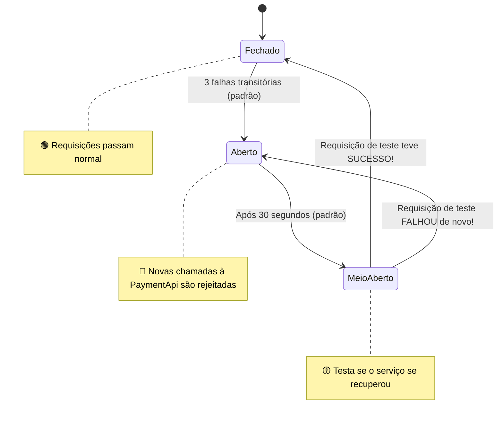

::: cuidado O Problema: Efeito Dominó
Imagine que a `PaymentApi` caiu ou começou a demorar 30 segundos para responder. Se 500 pessoas tentarem comprar na mesma hora, a `OrderApi` vai abrir 500 conexões HTTP simultâneas que ficam travadas esperando.

> A memória e o pool de conexões da `OrderApi` se esgotam. Resultado: **a OrderApi também cai**, derrubando o login, o carrinho e tudo mais. Uma falha pequena vira uma catástrofe global!
:::

::: dica O Nosso Objetivo
Instalar um **"disjuntor inteligente"** (usando a biblioteca Polly no .NET).

> A `OrderApi` protege a chamada à `PaymentApi` com Polly: por padrão, 3 respostas transitórias (5xx/408) ou timeouts abrem o circuito por 30 segundos. A política e esses limites são configurados no backend.
:::

::: nota Nota
**Implementação real:** o botão “Simular Falha” do laboratório Blazor envia um pedido pela API; em Development e no Docker Compose, a PaymentApi devolve 503 de demonstração. O pedido desfaz a reserva de estoque. Com o circuito aberto, a chamada de pagamento é rejeitada pela Polly, mas a saga ainda precisa chamar o estoque para compensar — portanto, o pedido completo não leva 0ms. A página estática abaixo é apenas um simulador visual independente.
:::

::: ilustracao img/lab-micro/circuit-breaker-infographic.jpg | Infográfico explicativo dos 3 estados do Circuit Breaker: Closed, Open e Half-Open
:::

**👁️ Entendendo a imagem num piscar de olhos:**

- **1. CLOSED STATE (Luz Verde):** O sistema está saudável. O tráfego elétrico flui livremente do Serviço A para o Serviço B.

- **2. OPEN STATE (Chave Vermelha Desarmada):** O serviço de destino começou a falhar. O disjuntor rejeita novas chamadas àquele serviço sem repetir a tentativa de rede.

- **3. HALF-OPEN STATE (Luz Amarela de Teste):** Após um tempo de descanso (cooldown), o disjuntor deixa passar **um único pulso cauteloso**. Se o serviço responder bem, a chave volta para o verde; se falhar, volta para o vermelho!

::: analogia Exemplo do Dia a Dia: O Disjuntor da Caixa de Luz da Sua Casa
Na parede da sua casa tem uma caixinha com vários disjuntores.

- Se você ligar o chuveiro, a air fryer e o ferro de passar na mesma tomada e houver uma sobrecarga elétrica, o disjuntor faz *"CLACK!"* e desliga a energia daquele cômodo na hora.
- **Por que ele faz isso?** Para impedir que os fios dentro da parede esquentem até pegar fogo e queimar a casa inteira!
- Em software, o **Circuit Breaker** protege uma dependência específica. No projeto, ele protege a chamada da `OrderApi` para a `PaymentApi` ; outras etapas do pedido, como compensar estoque, ainda podem fazer chamadas HTTP.
:::

**3️⃣ Os 3 Estados do Circuit Breaker (Passo a Passo)**

| Estado | O que acontece | Por quê? |
|---|---|---|
| **🟢 FECHADO (Closed)** | Tudo está funcionando normalmente. As requisições passam livremente. | O serviço de destino está saudável e respondendo dentro do tempo esperado. |
| **🔴 ABERTO (Open)** | Chamadas à PaymentApi são rejeitadas pela política enquanto o intervalo configurado não termina. | Evita novas tentativas de rede ao serviço de pagamento. Na saga deste projeto, a OrderApi ainda libera a reserva de estoque. |
| **🟡 MEIO-ABERTO (Half-Open)** | Após o intervalo, Polly permite uma chamada de prova à PaymentApi. | Uma resposta bem-sucedida fecha o circuito; uma falha transitória abre-o novamente pelo período configurado. |

#### Máquina de Estados do Circuit Breaker



```csharp Como configuramos no .NET com Polly C# / Polly
          // A política real protege somente as chamadas da OrderApi para PaymentApi.
          builder.Services.AddHttpClient("PaymentClient", client =>
          {
              client.BaseAddress = new Uri("http://paymentapi:8080");
          })
          .AddPolicyHandler((services, _) =>
              services.GetRequiredService<CircuitBreakerMonitor>().Policy);

          // Os padrões são 3 falhas transitórias e 30 segundos.
          // CircuitBreaker:FailureThreshold e CircuitBreaker:BreakDurationSeconds
          // podem substituir esses valores.
```
