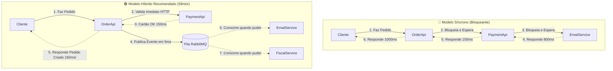

::: cuidado O Problema no Mundo Real
Se a cada clique do usuário sua API precisa chamar: 1. Estoque (espera 100ms) + 2. Pagamento (espera 150ms) + 3. Nota Fiscal (espera 500ms) + 4. Disparo de E-mail (espera 800ms) + 5. Notificação Push no celular (espera 400ms)...

> O tempo total passa de 2 segundos! E o pior: se o servidor de e-mail estiver fora do ar, **a compra inteira falha** mesmo que o cartão já tenha sido cobrado!
:::

::: dica O Nosso Objetivo
Dividir a comunicação em duas categorias inteligentes:

- **Síncrona:** Usar apenas para o que o usuário *precisa saber imediatamente* para continuar (ex: saldo suficiente no cartão).
- **Assíncrona:** Usar filas (RabbitMQ, Kafka, SQS) para tudo que pode acontecer nos próximos segundos sem travar a tela (ex: gerar nota fiscal, enviar e-mail de obrigado).
:::

::: ilustracao img/lab-micro/sync-async-infographic.jpg | Infográfico comparativo de comunicação síncrona bloqueante versus assíncrona desacoplada com filas
:::

**👁️ Entendendo a imagem num piscar de olhos:**

- **Lado Esquerdo (Síncrono / HTTP):** O usuário Alex fica preso olhando para a ampulheta. Cada serviço (User ➜ Order ➜ Payment ➜ Inventory) precisa responder em fila indiana. Tempo total de espera: **2000ms travados**! Se um falhar, a compra inteira cai.

- **Lado Direito (Assíncrono / Mensageria):** O usuário clica em "Comprar" e recebe confirmação verde em apenas **50ms**! A mensagem cai na esteira (RabbitMQ / Kafka) e robôs trabalhadores cuidam da separação e envio em segundo plano.

::: analogia vs 💬 Exemplo do Dia a Dia: Ligação Telefônica vs Mensagem no WhatsApp
#### 📞 Síncrono = Ligação Telefônica

Você liga para alguém. Você fala "Alô", e precisa que a pessoa esteja com o telefone no ouvido respondendo "Alô" naquele exato instante.

Se a pessoa não atender ou o sinal cair, a conversa não acontece e você fica esperando no mudo.

#### 💬 Assíncrono = Mensagem no WhatsApp

Você envia: "Segue o comprovante de pagamento". Você **não fica olhando para a tela** esperando a pessoa ler.

Você guarda o celular no bolso e vai almoçar. Quando a pessoa estiver disponível, ela lê a mensagem e processa o que tiver que processar.
:::

**2️⃣ Comparativo Passo a Passo: Quando Usar Cada Uma**

| Tipo | Como Funciona | Vantagens | Quando Usar? |
|---|---|---|---|
| Síncrono (HTTP / gRPC) | O serviço A chama o serviço B e **fica travado esperando** a resposta antes de prosseguir. | Simples de entender; resposta imediata para o usuário. | Consultas em tempo real (ex: checar login, validar senha, consultar saldo). |
| Assíncrono (Mensageria / Eventos) | O serviço A publica uma mensagem em uma fila (RabbitMQ/Kafka) e **continua sua vida imediatamente**. | Altíssimo desempenho; se o serviço de destino cair, a mensagem fica guardada na fila e não se perde. | Processamento de pedidos, envio de e-mails, emissão de nota fiscal, geração de relatórios. |

#### Fluxograma: Comparando o Bloqueio Síncrono vs Desacoplamento Assíncrono

