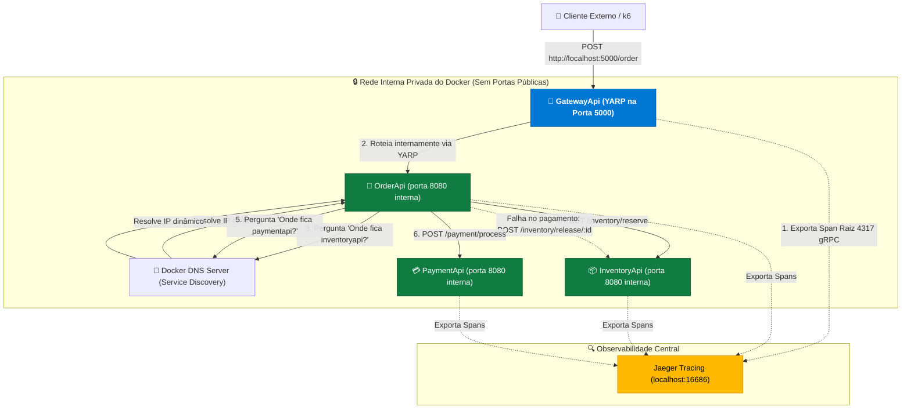

::: nota Nota
**Status da Implementação:** O projeto usa **YARP** para encaminhar `/order` à OrderApi; as APIs internas não publicam portas no host. O Compose publica o Gateway na porta 5000. O YARP deste laboratório não implementa autenticação: use esta configuração apenas em ambiente controlado e não exponha endpoints de demonstração em produção.
:::

::: cuidado O Problema: "Casa sem Muros" e IPs que Mudam Toda Hora
Imagine que você tem 10 microsserviços rodando na nuvem. Se cada um expuser sua própria porta para a internet:

- O aplicativo do cliente no celular precisaria saber 10 endereços e portas diferentes (ex: 5000, 5001, 5002...).
- **Risco grave de segurança:** Qualquer hacker ou usuário mal-intencionado pode chamar diretamente a `PaymentApi` ou a `InventoryApi` , pulando validações de login e regras de negócio!
- **O caos do IP dinâmico:** Toda vez que um contêiner reinicia no Docker ou no Kubernetes, ele ganha um IP diferente (ex: `172.18.0.5` hoje, `172.18.0.9` amanhã). Se colocássemos IPs fixos no código C#, a aplicação quebraria no primeiro reinício!
:::

::: dica A Solução Arquitetural Sênior
Resolvemos esses problemas dividindo as responsabilidades em duas peças mestras:

- **1. API Gateway (Microsoft YARP na porta 5000):** Um único ponto de entrada do laboratório local. As APIs internas não têm portas publicadas no host; YARP encaminha `/order` para OrderApi.
- **2. Service Discovery (DNS interno do Docker):** Os serviços conversam usando nomes lógicos amigáveis (ex: `http://inventoryapi:8080` e `http://paymentapi:8080` ). O servidor DNS do Docker intercepta o nome e resolve dinamicamente o IP do container em milissegundos!
:::

::: ilustracao img/lab-micro/api-gateway-discovery-infographic.jpg | Infográfico ilustrativo do API Gateway YARP protegendo microsserviços privados e Service Discovery via Docker DNS
:::

**👁️ Entendendo a arquitetura num piscar de olhos:**

1. **📱 O Cliente Externo (Mobile/Web):** Só conhece uma única porta: `http://localhost:5000`. Ele nunca fala direto com o banco, estoque ou pagamento.

2. **🚪 O API Gateway (Microsoft YARP):** Encaminha `/order` para a `OrderApi`. O OpenTelemetry instrumenta as requisições; YARP não implementa autenticação neste laboratório.

3. **🛡️ Rede Docker:** As APIs internas não têm portas publicadas no host. Em Docker Compose, contêineres na mesma rede ainda podem se comunicar; isso não substitui autenticação, firewall ou controles de produção.

4. **🤖 Robô de Service Discovery (Docker DNS):** Quando a `OrderApi` precisa falar com a `InventoryApi`, ela não sabe o IP. Ela pergunta para o robô DNS: *"Cadê o container inventoryapi?"*, e o Docker responde com o IP correto na hora!

::: analogia Exemplo do Dia a Dia: A Portaria do Condomínio Fechado & A Agenda do Celular
#### 🏢 API Gateway = Portaria de Condomínio Fechado

Imagine um condomínio residencial de luxo com 100 casas. As casas não têm portão aberto direto para a rua movimentada.

Existe uma **guarita única na entrada** com cancela e segurança armada. O entregador do iFood chega na guarita:

- O segurança confere o documento ( **Autenticação** ).
- Anota o horário de entrada no livro ( **Logs e Distributed Tracing** ).
- Diz: *"Pode entrar e levar até a casa número 14"* ( **Roteamento Reverso** ).

Se alguém tentar pular o muro direto na casa 14 (tentar acessar a porta 5001 de fora), o muro bloqueia!

#### 📖 Service Discovery = Agenda de Contatos do WhatsApp

Você decora o número de telefone de 8 dígitos de todos os seus amigos? Com certeza não!

No seu celular, você abre a agenda e clica no contato **"Mãe"**:

- Se a sua mãe trocar de operadora ou mudar de número amanhã, você só atualiza a agenda. Você continua clicando em "Mãe".
- O telefone consulta a agenda e disca para o número atualizado sem você precisar saber.

O **Docker DNS** é a agenda de contatos: a `OrderApi` chama o nome "inventoryapi", e o Docker cuida de achar o IP que mudou!
:::

### 1. O que JÁ implementamos de Service Discovery no nosso laboratório?

Implementamos o modelo de **DNS-based Service Discovery** — exatamente o mesmo princípio que o **Kubernetes CoreDNS** usa em produção nas maiores empresas do mundo!

No nosso `docker-compose.yml`, repare como a `OrderApi` chama os outros serviços através de variáveis de ambiente:

```
# Variáveis passadas para a OrderApi no docker-compose.yml
- InventoryApiUrl=http://inventoryapi:8080
- PaymentApiUrl=http://paymentapi:8080
```

**⚙️ Como funciona na prática:**

• A `OrderApi` não possui **nenhum IP fixo gravado no código C#**.

• Quando ela executa `await httpClient.GetAsync("http://inventoryapi:8080/inventory")`, a placa de rede virtual do Docker intercepta o nome `inventoryapi`.

• O servidor DNS embutido na rede `bridge` do Docker consulta sua tabela dinâmica interna, descobre que o container `inventoryapi` recebeu o IP `172.18.0.3`, e entrega a conexão transparente.

• *Por que não usamos HashiCorp Consul ou Netflix Eureka aqui?* Porque em ambientes conteinerizados modernos (Docker / Kubernetes), o DNS nativo da infraestrutura já resolve 100% da descoberta de serviços sem precisar de servidores extras complexos!

### 2. Por que o API Gateway NÃO estava implementado antes e o que fizemos agora?

Na versão inicial do nosso laboratório, as portas dos microsserviços estavam escancaradas no `docker-compose.yml`:

- `OrderApi` : porta 5000 exposta para o seu PC.
- `InventoryApi` : porta 5001 exposta para o seu PC.
- `PaymentApi` : porta 5002 exposta para o seu PC.

Isso significava que qualquer pessoa podia acessar `http://localhost:5002/payment` direto no navegador!

::: nota Nota
**O que o laboratório implementa:**

1. Criamos o microsserviço **GatewayApi** usando a biblioteca oficial da Microsoft **YARP (Yet Another Reverse Proxy)**.

2. Configuramos o YARP para ouvir na porta **5000** e rotear internamente: qualquer requisição para `/order` é encaminhada automaticamente para `http://orderapi:8080`.

3. As APIs internas não publicam portas no host no `docker-compose.yml`. Outros contêineres na rede ainda podem acessá-las; isso não substitui autenticação nem controles de produção.

4. Plugamos o **OpenTelemetry** no Gateway! Agora, quando você abre o **Jaeger**, o `gatewayapi` aparece orgulhosamente como o **primeiro nó (Root Span)** de toda a cadeia de execução!
:::

**Comparativo Arquitetural: Antes vs Depois da Implementação**

| Aspecto | Antes (Sem API Gateway) | Depois (Com YARP API Gateway) |
|---|---|---|
| **Portas Expostas** | ❌ Inseguro Portas 5000, 5001 e 5002 abertas direto no Windows. | ✅ Menor superfície exposta Porta 5000 do Gateway publicada; APIs internas sem portas publicadas no host. |
| **Ponto de Entrada** | O cliente chamava a `OrderApi` diretamente. | O cliente só fala com o `GatewayApi`, que distribui o tráfego. |
| **Segurança de Pagamento** | Qualquer um podia chamar `localhost:5002/payment` e forjar pagamentos. | As APIs internas não têm portas mapeadas no host deste Compose. Isso reduz a exposição, mas não impede chamadas de outros contêineres. |
| **Rastreamento Jaeger** | O Trace começava na `OrderApi` (3 serviços no grafo). | O Trace começa no `gatewayapi` (4 serviços encadeados: Gateway ➜ Order ➜ Inventory & Payment). |
| **Service Discovery** | Apenas entre `OrderApi` ➜ `Inventory`/`Payment` via Docker DNS. | Completo: Gateway descobre `OrderApi` via DNS, e ela descobre os outros serviços. |

**Passo a Passo Completo: Da Requisição do Cliente até a Resposta Final**

| Etapa | O que acontece | Por quê? |
|---|---|---|
| **1** | O cliente (navegador, app ou k6) faz uma requisição HTTP `POST http://localhost:5000/order`. | O cliente só conhece um único ponto de contato público centralizado (o API Gateway). |
| **2** | O **GatewayApi (YARP)** recebe a chamada. O OpenTelemetry gera um novo `TraceId` raiz e inicia o primeiro cronômetro (Span raiz). | Permite medir o tempo total percebido pelo usuário final no Jaeger e rastrear a requisição de ponta a ponta. |
| **3** | O YARP consulta sua tabela de rotas no `appsettings.json`, identifica que `/order` pertence ao cluster `order-cluster` e reencaminha a requisição para `http://orderapi:8080`. | O proxy reverso encaminha o tráfego de forma assíncrona com altíssima performance e sem travar threads. |
| **4** | O YARP injeta o cabeçalho padrão `traceparent` no HttpClient antes de enviar para a `OrderApi`. | Garante que a `OrderApi` continue o mesmo trace sem perder o histórico do Gateway. |
| **5** | A `OrderApi` valida a chave `Idempotency-Key` e reserva estoque em `POST /inventory/reserve`. | A OrderApi não tem nenhum IP fixo; ela usa o nome lógico definido no Service Discovery. |
| **6** | O **Docker DNS embutido** intercepta a chamada para `inventoryapi`, consulta sua tabela interna e entrega o IP privado do container. | Isso é o Service Discovery baseado em DNS: se o container reiniciar com outro IP, o Docker atualiza na hora sem quebrar a API! |
| **7** | Com a reserva, a `OrderApi` chama `POST /payment/process` protegida pelo Circuit Breaker da Polly. | O pagamento só é chamado após o estoque confirmar a reserva. |
| **8** | Se o pagamento falhar, a OrderApi chama `POST /inventory/release/{reservationId}`; no sucesso, responde com o identificador do pedido. | A compensação evita manter a reserva após uma falha de pagamento. A chave de idempotência é armazenada em memória por 10 minutos. |

#### Fluxograma Arquitetural da Solução com YARP e Rede Privada



```csharp 1. Código C# do GatewayApi (GatewayApi/Program.cs) C# / .NET 10 / YARP
using OpenTelemetry.Resources;
using OpenTelemetry.Trace;

var builder = WebApplication.CreateBuilder(args);

// 1. Configura o YARP Reverse Proxy lendo a seção "ReverseProxy" do appsettings.json
builder.Services.AddReverseProxy()
    .LoadFromConfig(builder.Configuration.GetSection("ReverseProxy"));

// 2. Instrumenta o OpenTelemetry para o Gateway ser o Root Span no Jaeger
builder.Services.AddOpenTelemetry()
    .ConfigureResource(resource => resource.AddService("gatewayapi"))
    .WithTracing(tracing =>
    {
        tracing
            .AddAspNetCoreInstrumentation() // Captura requisições de entrada na porta 5000
            .AddHttpClientInstrumentation() // Propaga o W3C traceparent para a OrderApi
            .AddOtlpExporter(opt =>
            {
                opt.Endpoint = new Uri(Environment.GetEnvironmentVariable("OTEL_EXPORTER_OTLP_ENDPOINT") ?? "http://jaeger:4317");
            });
    });

var app = builder.Build();

// Endpoint de saúde do próprio Gateway
app.MapGet("/gateway/health", () => Results.Ok(new 
{ 
    status = "Healthy", 
    gateway = "YARP (Yet Another Reverse Proxy)",
    role = "Single Entry Point"
}));

// 3. Ativa o pipeline de roteamento reverso do YARP
app.MapReverseProxy();

app.Run();
```

```json 2. Mapeamento de Rotas no Gateway (GatewayApi/appsettings.json) JSON / YARP Config
{
  "Logging": {
    "LogLevel": {
      "Default": "Information",
      "Microsoft.AspNetCore": "Warning",
      "Yarp": "Information"
    }
  },
  "ReverseProxy": {
    "Routes": {
      "order-route": {
        "ClusterId": "order-cluster",
        "Match": {
          "Path": "/order/{**catch-all}"
        }
      },
      "order-exact-route": {
        "ClusterId": "order-cluster",
        "Match": {
          "Path": "/order"
        }
      }
    },
    "Clusters": {
      "order-cluster": {
        "Destinations": {
          "order-service": {
            "Address": "http://orderapi:8080"
          }
        }
      }
    }
  }
}
```

```yaml 3. O docker-compose.yml com Portas Blindadas YAML / Docker Compose
services:
  # O ÚNICO SERVIÇO COM PORTA PÚBLICA EXPOSTA PARA O CLIENTE
  gatewayapi:
    build:
      context: ./GatewayApi
      dockerfile: Dockerfile
    container_name: gatewayapi
    ports:
      - "5000:8080"  # Apenas a porta 5000 do Gateway fica aberta!
    environment:
      - OTEL_EXPORTER_OTLP_ENDPOINT=http://jaeger:4317
      - OTEL_EXPORTER_OTLP_PROTOCOL=grpc
    depends_on:
      - jaeger
      - orderapi

  # TODAS AS OUTRAS APIS NÃO TÊM MAIS "ports:" EXPOSTAS NO HOST!
  orderapi:
    build:
      context: ./OrderApi
      dockerfile: Dockerfile
    container_name: orderapi
    # portas 5000:8080 foram REMOVIDAS do host para segurança!
    environment:
      - InventoryApiUrl=http://inventoryapi:8080  # Service Discovery via Docker DNS
      - PaymentApiUrl=http://paymentapi:8080      # Service Discovery via Docker DNS
      - OTEL_EXPORTER_OTLP_ENDPOINT=http://jaeger:4317
    depends_on:
      - jaeger
      - inventoryapi
      - paymentapi

  inventoryapi:
    build:
      context: ./InventoryApi
      dockerfile: Dockerfile
    container_name: inventoryapi
    # porta 5001 REMOVIDA do host!
    environment:
      - OTEL_EXPORTER_OTLP_ENDPOINT=http://jaeger:4317

  paymentapi:
    build:
      context: ./PaymentApi
      dockerfile: Dockerfile
    container_name: paymentapi
    # porta 5002 REMOVIDA do host!
    environment:
      - OTEL_EXPORTER_OTLP_ENDPOINT=http://jaeger:4317
```

🧪 Laboratório Prático

#### Teste você mesmo no seu computador agora!

Você pode testar exatamente essa segurança no terminal do seu Windows (PowerShell):

# 1. Teste o status de saúde do API Gateway na porta 5000: Invoke-RestMethod -Uri "http://localhost:5000/gateway/health" # 2. Crie um pedido idempotente (use uma chave nova por operação): $headers = @{ "Idempotency-Key" = [guid]::NewGuid().ToString("N") } Invoke-RestMethod -Uri "http://localhost:5000/order" -Method Post -Headers $headers # 3. Consulte o estado real do Circuit Breaker: Invoke-RestMethod -Uri "http://localhost:5000/order/circuit-breaker" # 4. No ambiente Development/Compose, simule falha de pagamento com outra chave: $failureHeaders = @{ "Idempotency-Key" = [guid]::NewGuid().ToString("N") } Invoke-RestMethod -Uri "http://localhost:5000/order?simulatePaymentFailure=true" -Method Post -Headers $failureHeaders # 5. TESTE DE BLINDAGEM: tente chamar a InventoryApi ou PaymentApi diretamente: # (A chamada não é publicada pelo Compose no host; isso não substitui autenticação # nem impede outros contêineres da rede interna de acessar o serviço.) Invoke-RestMethod -Uri "http://localhost:5001/inventory/reserve" -Method Post # 6. Abra o Jaeger no navegador: http://localhost:16686
