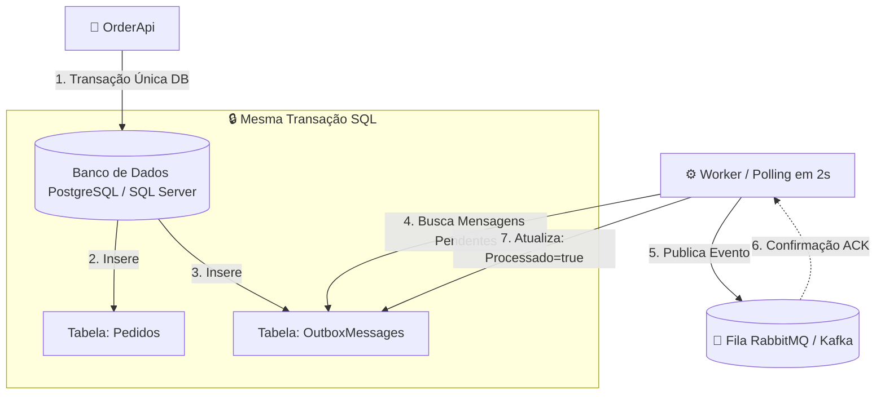

::: cuidado O Problema da Falha Dupla
Imagine o seguinte código comum:

`1. _banco.Pedidos.Add(pedido); await _banco.SaveChangesAsync();`

`2. await _rabbitMq.PublicarMensagemAsync("PedidoCriado");`

> E se o banco salvar, mas o servidor reiniciar **exatamente entre a linha 1 e a linha 2**? O pedido foi salvo, mas a mensagem nunca foi enviada! O estoque nunca vai saber que precisa separar o produto!
:::

::: dica O Nosso Objetivo
Criar uma tabela chamada `Outbox` **dentro do mesmo banco de dados** do serviço.

> Quando salvamos o pedido, gravamos a mensagem na tabela `Outbox` dentro da MESMA transação atômica do banco. Depois, um processo em segundo plano (Background Worker) lê a tabela e despacha as mensagens com segurança garantida.
:::

::: ilustracao img/lab-micro/outbox-infographic.jpg | Infográfico explicativo do Outbox Pattern com transação atômica em cofre, tabela de pedidos e mensagens e robô despachante
:::

**👁️ Entendendo a imagem num piscar de olhos:**

- **O Cofre com Cadeado Dourado (Transação Atômica):** A API grava no banco de dados duas tabelas juntas: `1. Tabela de Pedidos` e `2. Tabela de Mensagens Outbox`. Ou ambas são salvas juntas, ou nenhuma é salva! Zero chance de inconsistência.

- **O Robô Trabalhador em Background:** Um worker dedicado lê as mensagens pendentes na tabela Outbox e as despacha em segurança para a esteira (RabbitMQ/Kafka).

- **Selo de Entrega Garantida:** Somente após o RabbitMQ confirmar o recebimento, o robô atualiza o registro como "Processado".

::: analogia Exemplo do Dia a Dia: A Caixa de Saída de Cartas do Escritório
Em um escritório de advocacia, quando o advogado termina de escrever uma notificação importante:

- Ele **não larga a mesa de trabalho** e sai correndo até a agência dos Correios no meio da chuva.
- Ele simplesmente coloca a carta na bandeja etiquetada: **"Caixa de Saída" (Outbox)** em cima da mesa.
- Duas vezes por dia, o carteiro do prédio passa na mesa, recolhe todas as cartas que estão na caixa de saída e leva para os Correios despachar.
- Se chover forte de manhã, as cartas não se perdem: continuam guardadas com segurança na bandeja até o carteiro passar!
:::

**6️⃣ Ideia Geral (Passo a Passo)**

| Etapa | O que acontece | Por quê? |
|---|---|---|
| **1** | A `OrderApi` abre uma transação no banco de dados (`BEGIN TRANSACTION`). | Garante que ou tudo é salvo junto, ou nada é salvo (Atomicidade). |
| **2** | Salva a linha na tabela `Pedidos`. | Grava os dados comerciais do cliente. |
| **3** | Salva uma linha na tabela `OutboxMessages` com o conteúdo do evento (ex: `{ Evento: 'PedidoCriado', Status: 'Pendente' }`). | Como está na mesma transação, se a luz acabar aqui, o pedido e a mensagem são desfeitos juntos. Não há risco de inconsistência! |
| **4** | Faz o `COMMIT TRANSACTION`. | Os dois registros agora estão gravados em disco de forma definitiva. |
| **5** | Um `BackgroundService` (Worker) roda a cada 2 segundos, lê as mensagens pendentes da tabela `OutboxMessages` e publica no RabbitMQ/Kafka. | Desacopla a publicação de rede da requisição do cliente. |
| **6** | Assim que o RabbitMQ confirma o recebimento, o Worker marca a linha como `Status: 'Processado'`. | Garante que a mensagem não seja enviada novamente. |

#### Fluxograma Ilustrativo: Como o Outbox Pattern Garante a Entrega

