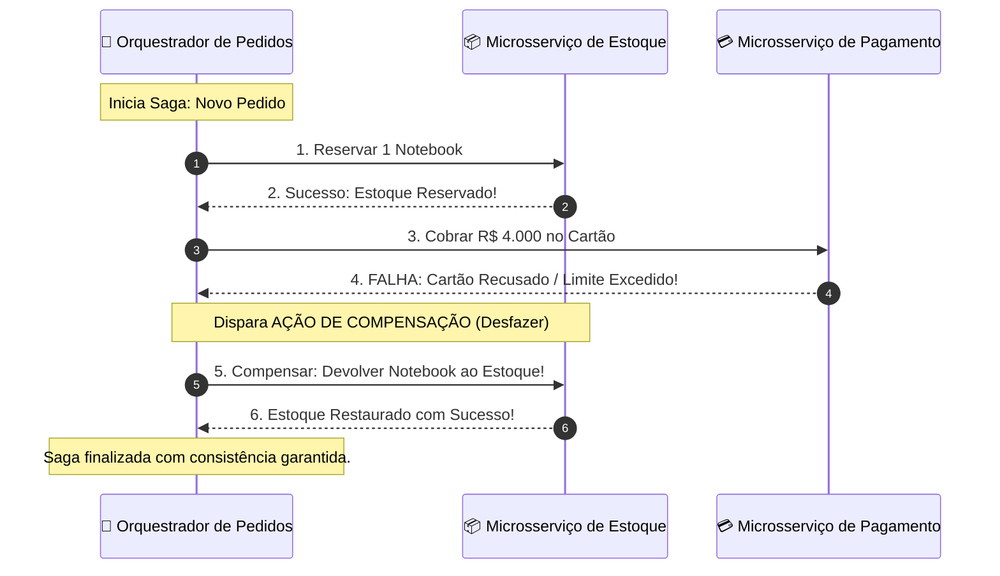

::: nota Nota
**O que este repositório implementa:** a OrderApi orquestra uma reserva de estoque seguida de pagamento. Se o pagamento falhar ou o Circuit Breaker estiver aberto, envia uma compensação para liberar a reserva. Para manter o exemplo simples, as reservas e os resultados de pedidos bem-sucedidos com idempotência ficam apenas na memória por 10 minutos; não há banco, cobrança persistida nem garantia de recuperação após reiniciar o processo. Falhas durante a própria compensação são registradas como erro crítico.
:::

::: cuidado O Problema: Sem BEGIN TRANSACTION
No banco de dados tradicional, se algo der errado você faz `ROLLBACK` e tudo volta como era antes. Mas em microsserviços, **cada serviço tem o seu próprio banco de dados isolado**!

> Se você reservou o item no banco do Estoque, mas 5 segundos depois o banco do Cartão de Crédito recusou a compra, o item ficou preso no estoque para sempre! Como devolver o estoque se os bancos são separados?
:::

::: dica O Nosso Objetivo
Implementar uma **Saga**: uma sequência de transações locais onde cada passo tem uma **Ação de Compensação** correspondente (o "desfazer").

> Se a etapa 3 falhar, a Saga dispara os comandos reversos da etapa 2 e da etapa 1: *"Devolver os 2 sapatos ao estoque"* e *"Marcar o pedido como cancelado"*.
:::

::: analogia Exemplo do Dia a Dia: Reserva de Pacote de Viagem (Passagem + Hotel + Carro)
Você entra numa agência para comprar um pacote para Paris com 3 itens:

1. A agência reserva a **Passagem Aérea** (Sucesso!).
2. A agência reserva o **Hotel** (Sucesso!).
3. A agência tenta reservar o **Aluguel do Carro** (Ops! Não tem mais carros disponíveis!).

A agência não vai te mandar para Paris sem hotel e sem carro deixando tudo pela metade. Ela executa ações de **compensação**. Em um sistema real, cada etapa precisa definir como desfazer seus efeitos; algumas compensações podem falhar e exigir reconciliação.
:::

**5️⃣ As Duas Formas de Fazer Saga: Orquestração vs Coreografia**

| Modelo | Como Funciona | Analogia | Vantagem |
|---|---|---|---|
| **Orquestração (Recomendada)** | Existe um serviço central (o "Orquestrador") que manda mensagens dizendo exatamente quem deve agir a cada passo. | 🎼 **O Maestro da Orquestra:** Ele aponta para o violino, depois para o piano. Se o piano errar, o maestro manda o violino parar. | Fácil de monitorar e entender onde o fluxo parou. |
| **Coreografia** | Não tem chefe central. Cada serviço faz seu trabalho e joga um evento na fila; o próximo serviço escuta e reage por conta própria. | 💃 **Dança em Roda:** Cada dançarino só faz o seu passo ao ver o movimento do parceiro do lado. | Totalmente descentralizado, ótimo para fluxos muito simples com 2 etapas. |

#### Fluxograma: Saga Orquestrada com Falha e Compensação

