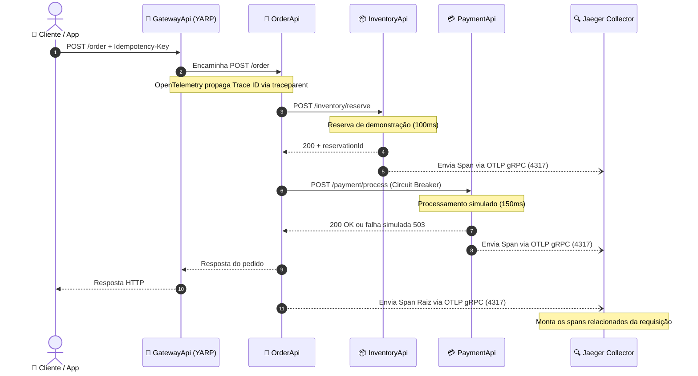

::: cuidado O Problema no Mundo Real
Imagine que um cliente clica em "Finalizar Compra" e a tela fica carregando por 10 segundos até dar erro. Em um sistema de microsserviços, a chamada passou por 4 ou 5 APIs diferentes (Pedidos, Estoque, Pagamento, Frete). **Como você descobre quem demorou ou onde quebrou?**

> Sem Distributed Tracing, você teria que abrir os logs de 5 servidores diferentes, procurando linhas de texto perdidas no meio de milhões de clientes simultâneos!
:::

::: dica O Nosso Objetivo
Colocar uma **"etiqueta única"** (chamada `Trace ID`) logo na primeira requisição do cliente. Conforme a requisição viaja de um serviço para o outro, essa mesma etiqueta é repassada no cabeçalho HTTP.

> No final, ferramentas como o **Jaeger** mostram uma linha do tempo gráfica perfeita dizendo: *"O Pedido levou 254ms no total: 98ms foram no Estoque e 151ms foram no Pagamento"*.
:::

::: ilustracao img/lab-micro/tracing-infographic.jpg | Infográfico explicativo de Distributed Tracing com Order, Inventory, Payment, Trace ID e Jaeger
:::

**👁️ Entendendo a imagem num piscar de olhos:**

1. **O Carrinho (Order Service):** O cliente clica em comprar. O sistema carimba uma etiqueta digital `Trace ID: #9842`.

2. **As Caixas no Galpão (Inventory Service):** A requisição vai até o estoque com a mesma etiqueta. O cronômetro mede **98ms**.

3. **A Maquininha de Cartão (Payment Service):** A requisição passa pelo cartão mantendo a mesma etiqueta. O cronômetro mede **151ms**.

4. **A Lupa do Jaeger:** O Jaeger junta todos os cronômetros e mostra na barra colorida: o pedido levou **254ms** no total, e o pagamento foi o maior responsável pelo tempo gasto!

::: analogia Exemplo do Dia a Dia: O Código de Rastreamento dos Correios
Quando você compra um tênis na internet, a loja te dá um código único de rastreio: `BR123456789SP`.

- Você **não precisa** ligar para o galpão de Curitiba, depois ligar para a transportadora de São Paulo, depois para o entregador da moto.
- Você simplesmente digita esse código no app e vê a linha do tempo completa: 🏪 Pedido postado (08:00) ➜ 🏭 Triagem no CD Cajamar (12:00) ➜ 🛵 Saiu para entrega (16:00) ➜ 🏠 Entregue (16:45)
- **Distributed Tracing é exatamente isso:** O `Trace ID` é o código de rastreamento da encomenda, e cada parada (etapa) é um `Span` !
:::

**1️⃣ Ideia Geral (Passo a Passo)**

| Etapa | O que acontece | Por quê? |
|---|---|---|
| **1** | O usuário faz `POST /order` pelo `GatewayApi`; a requisição inclui `Idempotency-Key`. | O Gateway é a entrada pública e encaminha a chamada para a OrderApi. |
| **2** | O OpenTelemetry gera automaticamente um identificador único (`Trace ID`: ex: `4bf92f3577b34da6a3ce929d0e0e4736`). | Ele garante que todas as etapas futuras tenham o mesmo identificador de rastreio pai. |
| **3** | A `OrderApi` chama `POST /inventory/reserve` e depois `POST /payment/process`, propagando o `traceparent`. | Para que a segunda API saiba que não é uma chamada solta, e sim parte daquele mesmo pedido. |
| **4** | A `InventoryApi` simula a reserva com um atraso de 100ms e responde com um `reservationId`. | Esse identificador permite à OrderApi desfazer a reserva se o pagamento falhar. |
| **5** | A `OrderApi` chama a `PaymentApi` com o mesmo `Trace ID`; a chamada tem um Circuit Breaker. | O pagamento é processado depois da reserva. Em caso de falha, a saga tenta liberar o estoque. |
| **6** | Todas as APIs enviam seus dados em segundo plano via OTLP (gRPC porta 4317) para o servidor do **Jaeger**. | Para centralizar os dados sem deixar a requisição do usuário mais lenta. |
| **7** | O desenvolvedor abre o **Jaeger UI** (porta 16686) e vê a linha do tempo com gráfico de barras colorido. | Permite enxergar gargalos de performance e erros em segundos, com precisão cirúrgica. |

#### Fluxograma Ilustrativo: Como a Informação Navega no Tracing



```csharp O que escrevemos no código .NET 10 (Program.cs) C# / OpenTelemetry
// 1. Configuração do OpenTelemetry com Tracing automático
builder.Services.AddOpenTelemetry()
    .ConfigureResource(resource => resource.AddService("orderapi"))
    .WithTracing(tracing =>
    {
        tracing
            .AddAspNetCoreInstrumentation() // Captura requisições que chegam
            .AddHttpClientInstrumentation() // Captura chamadas feitas para Inventory e Payment
            .AddOtlpExporter(options =>
            {
                // Envia para o Jaeger na porta 4317 usando protocolo gRPC
                options.Endpoint = new Uri("http://jaeger:4317");
            });
    });
```

#### 👁️ Exemplo Ilustrativo de um Trace

Tempos e spans são exemplos

**gatewayapi**: POST /order

254 ms (Span Raiz)

orderapi: POST inventory/reserve

101 ms

**inventoryapi**: POST /inventory/reserve

98.4 ms (Delay de verificação)

orderapi: client POST payment/process

153 ms

**paymentapi**: server POST /payment/process

151.2 ms (Processamento do cartão)

💡 *Neste exemplo ilustrativo, o pagamento é a etapa mais demorada. Use os traces do seu ambiente para identificar o gargalo real.*
